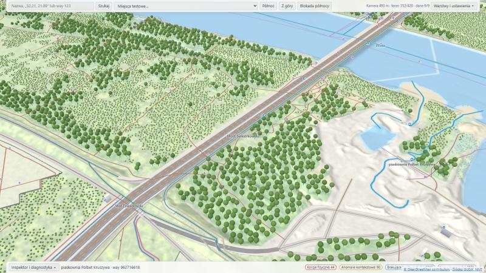
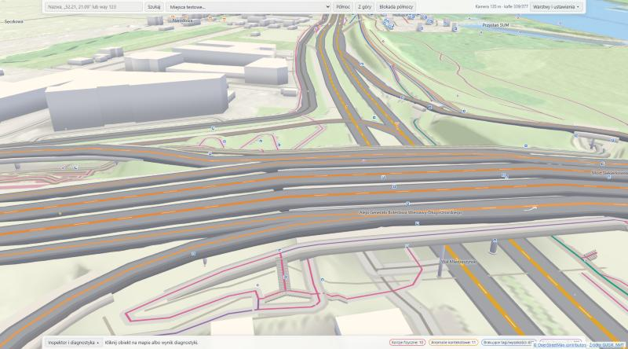
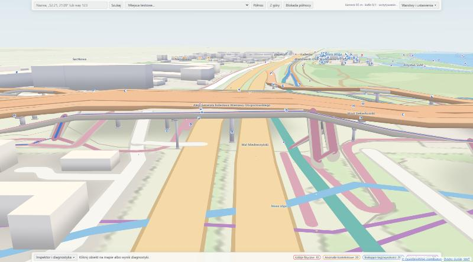
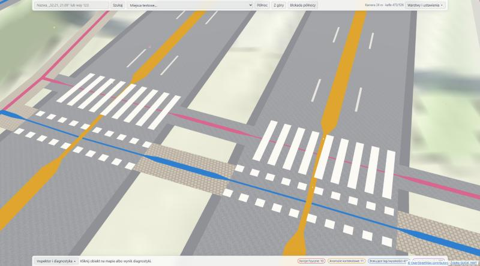
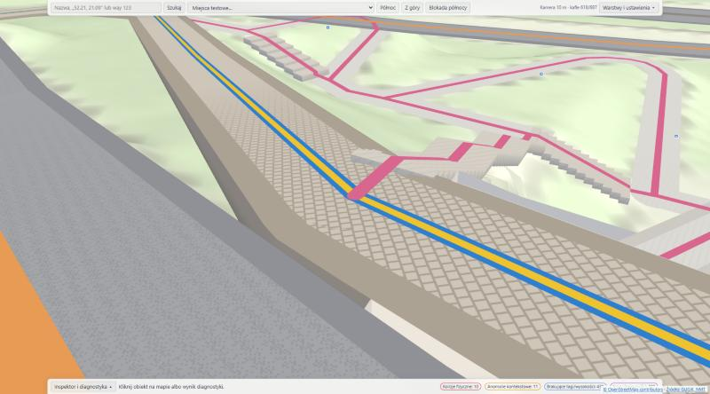
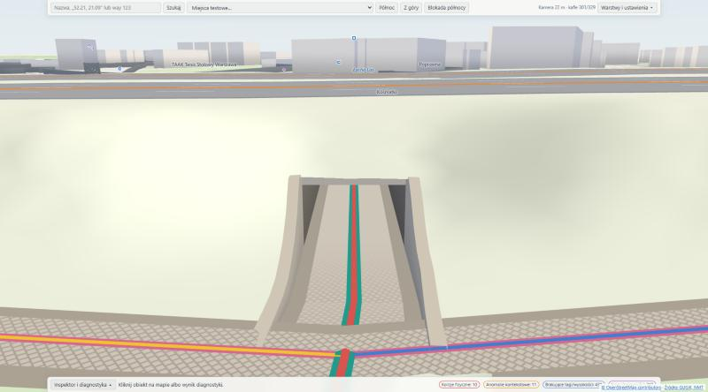
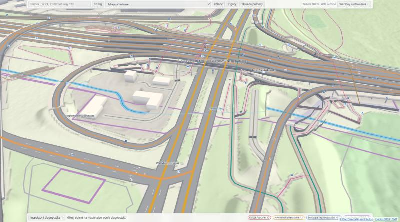
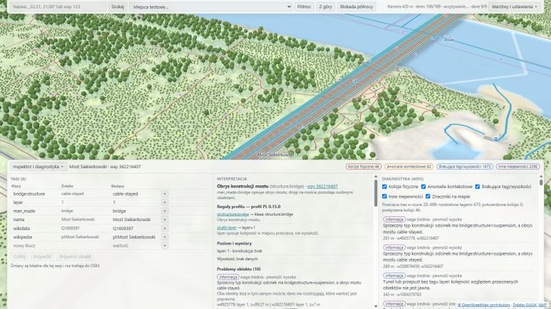
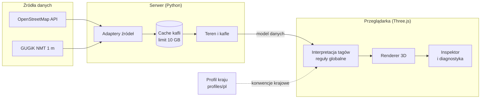

# 3D OSM

Projekt własnego, internetowego silnika map 3D opartego na danych OpenStreetMap i danych wysokościowych. Pierwszym kompletnym profilem geograficznym będzie Polska; prototyp skupi się na Warszawie i okolicach.



**Co robi prototyp**

- buduje scenę 3D z surowych danych OpenStreetMap i numerycznego modelu terenu GUGiK (siatka 1 m),
- odtwarza konstrukcje inżynierskie: mosty i estakady z podporami, tunele, przepusty, schody, nasypy i ściany oporowe,
- rysuje nawierzchnie i oznakowanie: pasy ruchu, przejścia dla pieszych, przejazdy rowerowe, strzałki,
- pokazuje budynki z dachami i częściami (`roof:shape`, `building:part`), roślinność, bariery i bramy,
- tłumaczy tagi OSM jawnymi, globalnymi regułami; różnice krajowe trzyma w profilu kraju (`profiles/pl`),
- ma inspektor obiektów i diagnostykę: nieznane lub sprzeczne tagi są zgłaszane, a nie zgadywane po cichu.

## Galeria

| | |
|:-:|:-:|
|  |  |
| Wielopoziomowy węzeł drogowy | Podpory estakad wyznaczone z geometrii |
|  |  |
| Oznakowanie poziome: przejścia i przejazdy | Schody i połączenia ścieżek na skarpie |
|  |  |
| Tunel: niecka w terenie i portal | Cieki wodne i przepusty pod drogami |

Więcej zrzutów porównawczych (przed i po zmianie reguł) jest w katalogu [`docs/podglad`](docs/podglad).

### Inspektor i diagnostyka

Kliknięcie obiektu pokazuje jego tagi źródłowe, regułę profilu, która go zinterpretowała, poziom i wymiary oraz wykryte problemy. Tagi można zmieniać lokalnie, w obrębie sesji, i od razu zobaczyć efekt; zmiany nie trafiają do OSM.



## Jak to działa



Dane źródłowe pozostają wierne: interpretacja nie nadpisuje tagów ani geometrii OSM, a styl kartograficzny jest osobnym krokiem po interpretacji. Szczegóły w dokumencie [Architektura](docs/02-architektura.md).

## Uruchomienie

Gotowa paczka jest w zakładce [Releases](https://github.com/FiLL25AG/3DOSM/releases). Pobierz plik `3DOSM-<wersja>.zip`, rozpakuj go i uruchom `start.cmd` dwuklikiem. Z repozytorium możesz też uruchomić aplikację poleceniem:

```powershell
.\run.ps1
```

Aplikacja działa pod adresem `http://127.0.0.1:8473`. Wymaga systemu Windows, Pythona 3.12 lub nowszego oraz dostępu do internetu przy pierwszym uruchomieniu (instalacja zależności i pobranie danych). Stan pierwszego wycinka opisuje [dokument decyzji implementacyjnych](docs/09-decyzje-implementacyjne.md).

## Dokumentacja

- [Założenia i decyzje](docs/01-zalozenia.md)
- [Architektura](docs/02-architektura.md)
- [Profile krajowe i kartografia](docs/03-profile-krajowe.md)
- [Zakres prototypu](docs/04-prototyp.md)
- [Plan dokumentacji i otwarte decyzje](docs/05-plan-i-otwarte-decyzje.md)
- [Inwentaryzacja źródeł i scenariuszy testowych](docs/06-inwentaryzacja-zrodel.md)
- [Przygotowanie przekazania do Claude Code](docs/07-przekazanie-do-claude-code.md)
- [Lista startowa pierwszego wycinka](docs/08-lista-startowa-claude-code.md)
- [Decyzje implementacyjne i stan wycinka](docs/09-decyzje-implementacyjne.md)

Dokumentacja opisuje kierunek projektu, nie stan implementacji. Szczegóły oznaczone jako otwarte wymagają późniejszej decyzji lub weryfikacji źródeł danych.

## Licencja

Kod projektu jest udostępniony na licencji [MIT](LICENSE). Biblioteki w `web/vendor` mają własne licencje, dołączone obok nich. Dane OpenStreetMap © współtwórcy OpenStreetMap, licencja ODbL.
